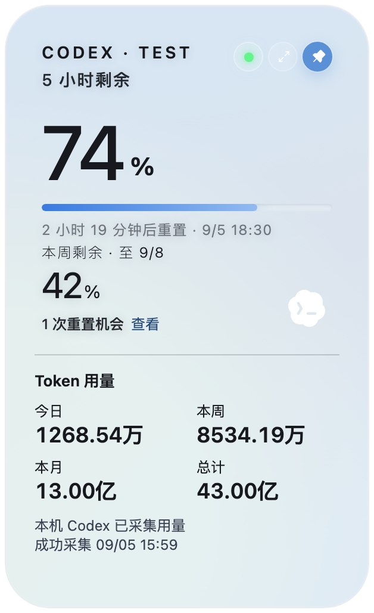

# Codex Monitor

A lightweight, local-first desktop resource monitor for Codex. See your remaining quota, quota reset times, and token usage on this machine in a floating widget.

当前已发布版本为 **v1.3.1**，下载见 [Codex Monitor v1.3.1](https://github.com/bennick1/codex-monitor/releases/tag/v1.3.1)，原版本状态见 [Fast 恢复验收报告](docs/fast-request-metadata-validation.md)。当前功能分支已合入该版本，并新增可关闭的后台更新检查；下载、验签与安装需要用户操作。普通开发构建未配置公钥时提供手动下载页。新增功能尚未正式发布，进度见 [发布流程](docs/RELEASE.md) 与 [主分支合并验收](docs/MAIN-MERGE-VALIDATION.md)。


## Features

- **Lightweight floating widget:** collapses into an orb, expands on hover, with pinning and tray controls.
- **Codex quota monitoring:** remaining 5-hour and weekly quota, reset times, and explicit unavailable/stale states.
- **Token usage statistics (Overview):** today, this week, this month, and the total collected on this machine. Summaries use `万` / `亿`; hover or focus a value for its full comma-separated count.
- **Per-model Token Statistics (By Model):** Today, Quota Period, 7 Days, 30 Days, and Total with model, Token count, and share. Today follows the local calendar day; Quota Period follows the valid Codex weekly quota window; 7 Days and 30 Days are exact rolling 7×24-hour and 30×24-hour windows rather than a natural week or current month; Total covers valid local history. Uncertain historical attribution appears as Unidentified.
- **Quota Week (额度周):** completed Turns in the current valid quota week, newest first, showing Model, Effort, Token, and Weekly Remaining. Without a reliable historical quota observation, Weekly Remaining shows `—`; historical quota is not estimated or backfilled.
- **Fast lightning indicator:** appears beside Effort when persisted local metadata indicates Fast selection/request (`priority` or `fast`); explicit `default` means Standard. v1.3.1 adds matching request metadata from the specific local `CODEX_HOME/logs_2.sqlite` diagnostic source. `feature.fast_mode=true` alone is insufficient; missing, mismatched, or conflicting evidence remains Unknown. Evidence persists across restarts but does not prove the server execution tier or the tier of every request in the Turn. Historical v1.3.0 conclusions remain in its original release report.
- **Four free built-in skins:** Default (Follow system, Dark, or Light), Blur, Computer, and Mecha Light. Mecha Light adds silver-white armor and blue, amber, and red quota states across expanded and collapsed views. Skin selection is local, persists across restarts, and has no activation step.
- **Overall widget opacity:** 60%–100% in 5% steps, default 100%. Background, text, icons, and decorations fade together across all four skins; the preference is restored after restart.
- **Local-first:** incremental session scanning and a local SQLite database; no cloud synchronization or telemetry.
- **Windows/macOS support:** a shared interface with Light, Dark, and Follow system appearances and Chinese/English labels. Platform acceptance is tracked separately in the release report.

Quota comes from the Codex service. Local token counts are a separate measurement and are not used to estimate quota. Totals cover recognized local history, not all usage across your account or devices; incomplete history is marked in the widget.

Mecha Light's three fixed Chinese Tab labels use approved-reference-derived image patches with real buttons, accessible names, and text fallback. Font substitution, text-only enlargement, and custom foreground colors have known limits; enlarged labels interpolate 1× bitmaps. Native screen-reader and complete WCAG acceptance are not claimed. The recorded zero-pixel-difference result is limited to the documented 258×36, DPR1, 100% conditions and direct-reference states. Manual Reset still has no observable success signal. See the [validation report](docs/v1.3.0-feature-validation-report.md) for the full evidence boundaries.

## 侧边栏模式

从菜单的“展示模式”选择“侧边栏”；原有悬浮窗模式继续保留。侧边栏默认贴右侧，菜单栏图标随之隐藏。移入 6×48 像素的实色小拉手展开圆角竖条，悬停额度圆环查看详情；底部圆弧悬停后平滑展开为齿轮，点击进入设置。上方对称圆弧悬停后显示当前贴靠方向，点击按“右侧 → 左侧 → 顶部 → 右侧”切换，也可在设置中选择。顶部贴靠沿屏幕可用区域上沿居中，服务横向排列，方向和设置按钮分列左右，详情向下展开。拉手不受透明度设置影响。详情始终向屏幕内展开；操作菜单或键盘焦点位于组件内时保持展开，点击设置外部会收起，其余情况离开 450 毫秒后收起。再次打开应用会显示窗口并解除鼠标穿透。

- **外观：** 侧边栏支持浅色、深色和跟随系统，与悬浮窗共用已有外观偏好。跟随系统时，背景、文字、图表和图标同步切换，无需重启；拉手随主题切换，但保持实色。macOS 通过原生鼠标监听补充 WebView 悬停事件，让未激活的侧边栏也能响应移入。
- **侧边栏大小：** 齿轮菜单支持 80%–130% 缩放，拖动时实时调整，默认 100%，重启后保留。仅拉手、栏体和两端快捷按钮缩放，鼠标命中区域同步调整；详情与设置保持原字号和尺寸，随栏宽向内平移。工作区不足时限制栏体大小，并保留所选比例；面板按可见空间限制宽高。系统启用减少动态效果时，弧线与按钮直接切换。
- **剩余口径：** Pro 系列的侧边栏只显示每周额度，周数据缺失时显示 `—`；这是展示选择，未改变接口采集或悬浮模式。其他订阅优先显示 5 小时剩余额度，缺失时使用周额度。DeepSeek 显示 `余额 ÷（余额 + 累计费用）`，不是套餐配额或充值记录，分母为零时显示 `—`。
- **账户与本机分开：** 侧边栏仅展示账户累计、单日峰值、最长对话、连续天数和每日 Token；本机 SQLite 统计保留在悬浮模式。缺失账户数据不补零，也不用 Token 推算额度。
- **DeepSeek：** 通过齿轮中的“登录 / 管理 DeepSeek”打开独立的开放平台窗口；登录后读取余额、费用、请求数、API 密钥数量及近 30 个自然日统计。退出登录会清理此窗口的网站数据。网站接口可能变化，读取失败会明确显示未更新状态。
- **验证范围：** 见 [侧边栏验收记录](docs/SIDEBAR-VALIDATION.md)；侧边栏代码不代表既有 v1.3.1 安装包已包含此功能。

## 界面预览




Rendered from the current components with synthetic `CODEX · TEST` data. No personal screenshots or statistics are included. This preview is not platform acceptance evidence.

## Installation

Download only from [Codex Monitor Releases](https://github.com/bennick1/codex-monitor/releases). Do not use the upstream project's installers for this fork.

| Platform | v1.3.1 installer | Install |
| --- | --- | --- |
| macOS | `Codex-Monitor-1.3.1.dmg` | Open the disk image and drag **Codex Monitor.app** to Applications. |
| Windows | `Codex-Monitor-1.3.1.exe` | Run the installer as your normal user, then use the **Codex Monitor** Start menu entry. |

The v1.3.1 macOS App and DMG are **Unsigned / Not Notarized**; the Windows installer is **Unsigned**. The macOS executable has only a linker ad-hoc signature; strict App bundle signature verification does not pass. macOS may show a Gatekeeper warning and Windows may show an unknown-publisher or SmartScreen warning. The macOS app is not Apple verified, notarized, or signed with an Apple Developer ID. Compare the download with the release's `SHA256SUMS` before installing.

For an existing Quota Float installation, quit the old app and preserve its application data before installing. V1 retains the old application identifier to keep settings and token history accessible. After upgrading, verify that the renamed installer and login/startup entry point to Codex Monitor; see the [migration inventory](docs/v1.0.0-name-migration-inventory.md). Do not run both copies together.

v1.3.1 keeps application compatibility version **4** and adds a supplemental request-evidence table; existing core tables, accounting, and statistical rules are unchanged. Schema 4 was introduced in v1.2.1 for persisted Fast selection metadata while preserving existing accounting data through migration. Compatibility is checked using isolated fixtures, not by downgrading a production database.

## Usage

1. Sign in to Codex on this machine, then launch Codex Monitor.
2. Hover over the orb to view quota and Token Statistics. Pin the card to keep it expanded.
3. Hover or focus each Token value to see the exact count, such as `12,685,398` for `1268.54万`.
4. Use the tray menu to refresh, open the manual release download page, switch among the Default, Blur, Computer, and Mecha Light skins, set overall opacity, change language/appearance, show or hide the widget, or quit.

macOS 应用没有 Dock 或 Command-Tab 入口。悬浮窗模式显示菜单栏图标，侧边栏模式从齿轮进入菜单；悬浮卡片也提供菜单按钮。全屏 Space 和睡眠唤醒需单独完成实机验收。

Both readers respect `CODEX_HOME`; otherwise they use your home directory's `.codex` folder (`%USERPROFILE%\.codex` on Windows). The token collector scans `sessions` and `archived_sessions`, independently of quota login/network availability. Fast can also use the narrowly scoped diagnostic metadata described above, through a read-only connection; an unavailable source does not block accounting. Initial scans and bounded historical request replay may take time. Cleaned logs without other trustworthy evidence can leave historical Turns Unknown, while previously collected statistics and request evidence remain in the local database.

## Privacy

Codex Monitor does not collect or retain prompts, chat history, source code, or account credentials in its statistics database, logs, or telemetry. Statistics stay on this machine.

读取 Codex 额度和账户统计时，应用复用本机 `auth.json`，仅向所需 ChatGPT 接口发送已有凭据，不复制保存 Codex 凭据。本机 Token 采集器跳过消息正文，只存储计数、时间、哈希身份、来源引用及检查点。补充的 Fast 证据仅保存哈希 root/thread/Turn 键及 tier 标志，不保存原始诊断记录、`tags_json` 或凭据。可选 DeepSeek 登录使用独立网站数据容器，由系统 WebView 管理会话，详情见 [隐私说明](PRIVACY.md)。


There is no analytics, tracking, account system, or cloud sync. See [PRIVACY.md](PRIVACY.md) for network and storage details and [SECURITY.md](SECURITY.md) for reporting guidance.

## Development

Requirements: Node.js 22, Rust stable, and the [Tauri 2 prerequisites](https://v2.tauri.app/start/prerequisites/) for your platform. Windows builds require the MSVC toolchain and WebView2; macOS builds require Apple command-line developer tools.

```sh
npm ci
npm test
cargo test --manifest-path src-tauri/Cargo.toml --locked
npm run build
npm run tauri -- dev
```

`npm run dev` is a browser preview with mock data. It cannot validate desktop authentication, native windows, or SQLite integration. Report issues through [Codex Monitor Issues](https://github.com/bennick1/codex-monitor/issues), with personal information removed.

## Build

Run on macOS for an Apple Silicon package:

```sh
npm run tauri -- build --bundles app,dmg --config '{"bundle":{"createUpdaterArtifacts":false}}'
```

For a Universal macOS package, first install both Rust targets and add `--target universal-apple-darwin`. An arm64 package alone is not an Intel build.

Run in PowerShell on Windows for an NSIS installer:

```powershell
npm run tauri -- build --bundles nsis --config '{"bundle":{"createUpdaterArtifacts":false}}'
```

这些普通本地构建命令不生成 updater 制品；正式在线升级仅通过经过门禁的手动发布 workflow，使用独立签名配置生成制品。 Platform signing requires separately configured maintainer certificates. Output is under `src-tauri/target/release/bundle/`, or the target-specific directory for a Universal build.

The frozen Branding sources are in [docs/branding/v1.2](docs/branding/v1.2/); production icons generated from them are in [src-tauri/icons](src-tauri/icons/).

The [release preparation guide](docs/RELEASE.md) covers naming, SHA256, build provenance, and validation. CI compilation and artifact creation do not replace installation and use on real Windows/macOS machines. No GitHub Release should be created until the maintainer approves the completed report.

## License

[MIT](LICENSE). Based on [Quota Float](https://github.com/change-42-yhmm/quota-float); the original copyright notice is preserved. Codex Monitor is an independent project and is not an official OpenAI product.
